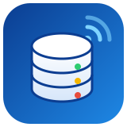
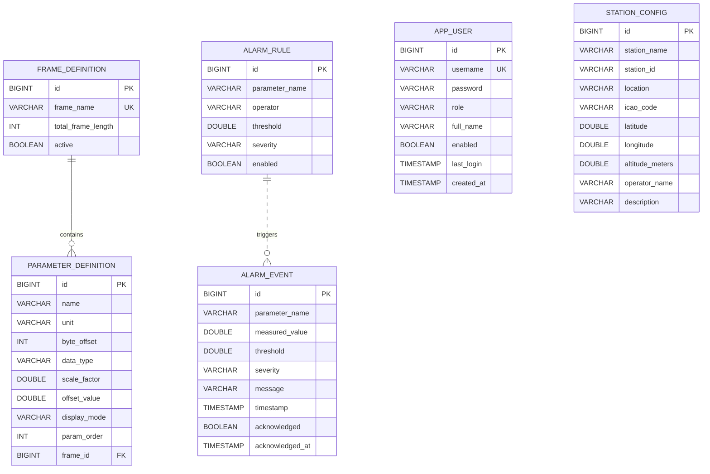

<div align="center">



# 🗄️ UASS SCADA — Database

**SQL database layer for the Upper Air Sounding System real-time telemetry dashboard**


</div>

---

## 📑 Table of Contents

- [📖 About](#-about)
- [👤 My Role](#-my-role)
- [🛠️ Tech Stack](#️-tech-stack)
- [🗺️ Entity Relationship Diagram](#️-entity-relationship-diagram)
- [📋 Tables](#-tables)
- [📂 What's in the SQL file](#-whats-in-the-sql-file)
- [⚙️ Database Design Highlights](#️-database-design-highlights)
- [🚀 How to Run](#-how-to-run)
- [🔍 Sample Queries](#-sample-queries)
- [📁 Repository Structure](#-repository-structure)

---

## 📖 About

**UASS SCADA** (Upper Air Sounding System) is a full-stack real-time telemetry monitoring
platform for upper air atmospheric sounding ground stations, built during an internship
on a **DRDO** project.

Sensors measure 🌬️ wind, 🌡️ temperature, 💧 humidity and 📉 pressure in the atmosphere and
send binary frames to the ground station. The system parses them, shows them live on a
dashboard, and raises alarms when values cross set limits.

> **SCADA** = *Supervisory Control And Data Acquisition* — software that collects live
> sensor data, displays it to operators and raises alarms.

## 👤 My Role

I was responsible for the **database, end to end**:

- 🧩 Designed the relational schema for users, telemetry frame layouts, alarms and station settings
- 🔗 Mapped JPA entities to tables with keys, relationships and constraints
- 🌱 Wrote the seed data loaded on first startup
- 📝 Wrote the SQL for every query the backend runs (login, frame editor, alarms, station config)
- 📊 Added reporting, validation and maintenance queries for operators and admins

## 🛠️ Tech Stack

| | Technology | Used for |
|---|---|---|
| 🗄️ | **H2 Database** | Embedded SQL database (`jdbc:h2:mem:uassdb`) |
| 🔄 | **Hibernate / Spring Data JPA** | ORM and repository queries |
| 🌱 | **Spring Boot 4.1** | Backend application |
| ☕ | **Java 17** | Language |
| 🔐 | **BCrypt + JWT** | Password hashing and login tokens |

## 🗺️ Entity Relationship Diagram



## 📋 Tables

| Icon | Table | Purpose |
|:---:|---|---|
| 👤 | `app_user` | Operator accounts — `ADMIN` / `OPERATOR` roles, BCrypt passwords, last login |
| 📦 | `frame_definition` | Layout of the incoming binary telemetry frame (only one active at a time) |
| 🔢 | `parameter_definition` | Fields inside a frame — byte offset, data type, scale, offset, display mode |
| ⚠️ | `alarm_rule` | Threshold rules (`ABOVE` / `BELOW`) with severity `INFO` / `WARNING` / `CRITICAL` |
| 🚨 | `alarm_event` | History of triggered alarms and operator acknowledgements |
| 📡 | `station_config` | Ground station site details (single row, `id = 1`) |

## 📂 What's in the SQL file

[`database/uass_database.sql`](database/uass_database.sql)

| # | Section | Contents |
|:---:|---|---|
| 1️⃣ | **Schema** | 6 tables, primary & foreign keys, unique and `CHECK` constraints, indexes |
| 2️⃣ | **Seed data** | Station config, 2 default alarm rules, default 22-byte frame with 10 sensor parameters |
| 3️⃣ | **Application queries** | SQL behind every JPA repository method — auth, frames, parameters, alarms, station config |
| 4️⃣ | **Monitoring & maintenance** | Alarm statistics, operator response time, frame validation, user audit, cleanup |

## ⚙️ Database Design Highlights

- 🔗 **One-to-many with cascade** — deleting a frame removes its parameters automatically
- 🛡️ **Data integrity in the database** — `CHECK` constraints for data types, display modes,
  alarm operators, severities, roles, and valid latitude / longitude
- 1️⃣ **Singleton config row** — `station_config` is limited to `id = 1`
- ✅ **One active frame** — saving a frame deactivates the old one in the same transaction
- ⚡ **Indexes** on the hottest lookups: active frame, enabled rules, latest alarms, unacknowledged count
- 🔐 **No plain-text passwords** — only BCrypt hashes are stored
- 💾 **Right data in the right place** — live sensor readings stream over WebSocket and stay
  in memory; the database keeps configuration, users and alarm history

## 🚀 How to Run

1. ▶️ Start the UASS backend.
2. 🌐 Open the H2 console at `http://localhost:9093/h2-console`
   - **JDBC URL:** `jdbc:h2:mem:uassdb`
   - **User:** `sa` (no password)
3. 📥 Run **sections 1 and 2** of `uass_database.sql` to create the schema and load seed data.
4. 🔍 Run any query from **sections 3 and 4**. Replace named parameters such as
   `:username` or `:id` with real values.

> ℹ️ Tested on **H2 2.4**. Sections 1–3 use standard SQL. A few date functions in
> section 4 (`DATEDIFF`, `FORMATDATETIME`, `DATEADD`) are H2-specific.

## 🔍 Sample Queries

**🚨 Latest 50 alarms** (alarms page)

```sql
SELECT id, parameter_name, measured_value, threshold, severity, message,
       timestamp, acknowledged, acknowledged_at
FROM alarm_event
ORDER BY timestamp DESC
LIMIT 50;
```

**📊 Alarm summary by severity**

```sql
SELECT severity,
       COUNT(*)                                      AS total_alarms,
       SUM(CASE WHEN acknowledged THEN 0 ELSE 1 END) AS unacknowledged
FROM alarm_event
GROUP BY severity;
```

**🧪 Find overlapping byte ranges in a frame** (frame validation)

```sql
WITH ranges AS (
    SELECT frame_id, id, name, byte_offset AS start_byte,
           byte_offset + CASE data_type
                WHEN 'INT8' THEN 1 WHEN 'UINT8' THEN 1
                WHEN 'INT16' THEN 2 WHEN 'UINT16' THEN 2
                WHEN 'INT32' THEN 4 WHEN 'UINT32' THEN 4
                WHEN 'FLOAT32' THEN 4 WHEN 'FLOAT64' THEN 8 END AS end_byte
    FROM parameter_definition
)
SELECT a.name AS parameter_a, b.name AS parameter_b
FROM ranges a
JOIN ranges b ON a.frame_id = b.frame_id AND a.id < b.id
             AND a.start_byte < b.end_byte AND a.end_byte > b.start_byte;
```

## 📁 Repository Structure

```
uass-scada-database/
├── 📄 README.md
├── 🖼️ assets/
│   └── logo.svg
└── 🗄️ database/
    └── uass_database.sql
```

---

<div align="center">

Made with 🗄️ by **Sonu Ray** · Internship Project · Upper Air Sounding System

</div>
